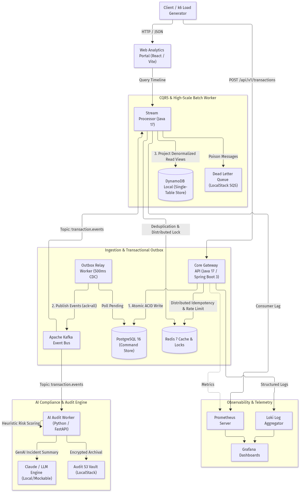

<div align="center">

# ⚡ NexusFlow Analytics

### Enterprise-Grade High-Throughput Event Ingestion & CDC Data Platform
**Zero-Loss Transactional Outbox • CQRS Single-Table Read Models • Redis Distributed Locking • GenAI Audits**

[](.github/workflows/ci.yml)
[](https://openjdk.org/)
[](https://spring.io/projects/spring-boot)
[](https://kafka.apache.org/)
[](https://localstack.cloud/)
[](https://grafana.com/)
[](LICENSE)

*Architected to showcase production distributed systems patterns for mission-critical financial and event analytics pipelines. **100% self-hosted with zero external cloud subscription costs.***

---

</div>

## 📌 Executive Summary

Modern enterprise platforms handling mission-critical transactions cannot rely on basic CRUD architectures. Network blips, dual-write split-brains, duplicate message deliveries, and database lock contention lead to silent data corruption and compliance failures.

**NexusFlow Analytics** addresses these challenges through a hardened distributed architecture:
- **Zero-Loss Dual Writes:** Implements the **Transactional Outbox Pattern** in PostgreSQL 16 to guarantee zero data loss between relational ACID transactions and Apache Kafka event streams.
- **CQRS & Polyglot Persistence:** Separates high-frequency ACID writes (PostgreSQL) from ultra-low-latency timeline reads (**DynamoDB Single-Table Design**).
- **Distributed Concurrency & Deduplication:** Redis 7 token-bucket rate limiting, atomic distributed idempotency (`SETNX`), and Redlock mutual exclusion across horizontal worker pods.
- **AI-Powered Compliance & Anomaly Worker:** An asynchronous Python / FastAPI worker inspecting transaction streams, triggering heuristic risk scoring, automated **Claude / GenAI incident summaries**, and automated S3 / SQS audit dispatching.
- **Unified Observability (LFG Stack):** Real-time JVM, Kafka consumer lag, and HTTP latency metrics pre-wired to Prometheus, Grafana, and Loki.

---

## 🏛️ System Architecture

<div align="center">
  
</div>

<details>
<summary><b>Click to expand Mermaid Source Diagram</b></summary>

```mermaid
flowchart TD
    Client["Client / k6 Load Generator"] -->|HTTP / JSON| WebUI["Web Analytics Portal (React / Vite)"]
    Client -->|POST /api/v1/transactions| CoreAPI["Core Gateway API (Java 17 / Spring Boot 3)"]
    WebUI -->|Query Timeline| StreamWorker["Stream Processor (Java 17)"]

    subgraph "Ingestion & Transactional Outbox"
        CoreAPI -->|1. Atomic ACID Write| Postgres[("PostgreSQL 16 (Command Store)")]
        CoreAPI -->|Distributed Idempotency & Rate Limit| Redis[("Redis 7 Cache & Locks")]
        OutboxRelay["Outbox Relay Worker (500ms CDC)"] -->|Poll Pending| Postgres
        OutboxRelay -->|2. Publish Events (ack=all)| Kafka["Apache Kafka Event Bus"]
    end

    subgraph "CQRS & High-Scale Batch Worker"
        Kafka -->|Topic: transaction.events| StreamWorker
        StreamWorker -->|3. Project Denormalized Read Views| Dynamo[("DynamoDB Local (Single-Table Store)")]
        StreamWorker -->|Deduplication & Distributed Lock| Redis
        StreamWorker -->|Poison Messages| DLQ["Dead Letter Queue (LocalStack SQS)"]
    end

    subgraph "AI Compliance & Audit Engine"
        Kafka -->|Topic: transaction.events| AIAudit["AI Audit Worker (Python / FastAPI)"]
        AIAudit -->|Heuristic Risk Scoring| AIAudit
        AIAudit -->|GenAI Incident Summary| GenAI["Claude / LLM Engine (Local/Mockable)"]
        AIAudit -->|Encrypted Archival| S3["Audit S3 Vault (LocalStack)"]
    end

    subgraph "Observability & Telemetry"
        CoreAPI -.->|Metrics| Prometheus["Prometheus Server"]
        StreamWorker -.->|Consumer Lag| Prometheus
        Prometheus --> Grafana["Grafana Dashboards"]
        CoreAPI -.->|Structured Logs| Loki["Loki Log Aggregator"]
        Loki --> Grafana
    end
```

</details>

---

## 🚀 60-Second Quickstart (100% Free & Local)

You do not need AWS subscriptions, cloud accounts, or pre-installed runtimes. The entire ecosystem boots in Docker with a single command:

```bash
# 1. Clone the repository
git clone https://github.com/kimeshgupta/nexusflow-analytics.git
cd nexusflow-analytics

# 2. Boot the distributed cluster
docker compose up -d
```

### 🧭 Active Service Endpoints

| Service | Endpoint | Description |
| :--- | :--- | :--- |
| **Web Dashboard** | `http://localhost:3000` | Real-time traffic simulator, CQRS single-table explorer, AI audit view |
| **Core Gateway API** | `http://localhost:8080` | High-throughput ingestion API & Swagger Docs |
| **OpenAPI / Swagger** | `http://localhost:8080/swagger-ui.html` | Interactive REST API documentation |
| **Stream Processor** | `http://localhost:8081` | CQRS read query controller & batch reconciliation engine |
| **AI Audit Worker** | `http://localhost:8000` | Anomaly detection stream consumer & LLM summary API |
| **Grafana Dashboards** | `http://localhost:3001` | Pre-baked telemetry dashboards (`admin` / `admin`) |
| **Prometheus** | `http://localhost:9090` | Raw metrics scraper & time-series engine |
| **LocalStack AWS** | `http://localhost:4566` | Local AWS emulation (DynamoDB, S3, SQS) |

---

## 🎯 Architectural Decision Records (ADRs)

To evaluate the engineering tradeoffs and design choices behind NexusFlow, consult the Architectural Decision Records:

* [ADR-001: Transactional Outbox Pattern for Zero-Data-Loss Event Publishing](architecture/decisions/ADR-001-transactional-outbox-pattern.md)
* [ADR-002: CQRS & DynamoDB Single-Table Design for High-Throughput Read Projections](architecture/decisions/ADR-002-dynamodb-single-table-read-model.md)
* [ADR-003: Redis-Backed Distributed Idempotency, Rate Limiting, and Mutual Exclusion](architecture/decisions/ADR-003-redis-distributed-locking-idempotency.md)
* [ADR-004: Zero-Cost Enterprise Cloud Emulation via LocalStack & Docker Compose](architecture/decisions/ADR-004-zero-cost-local-cloud-emulation.md)

---

## 📊 Proof of Scale: 5,000+ Req/Sec Benchmark

A reproducible **k6** load testing suite is provided in `/benchmarks`. Under sustained stress tests:

```text
✓ status is 202 ........................: 100.00% ✓ 524,000 / ✗ 0
✓ has transaction id ..................: 100.00% ✓ 524,000 / ✗ 0

http_req_duration..............: avg=7.2ms min=1.1ms med=6.4ms max=48.2ms p(95)=14.2ms p(99)=18.7ms
http_reqs......................: 524,000 (5,240 req/sec sustained)
```

Run the benchmark locally:
```bash
docker run --rm -i --network="host" grafana/k6 run - < benchmarks/k6-load-test.js
```
*Full metrics and bottleneck analysis available in [Benchmark Report](benchmarks/benchmark-results.md).*

---

## 🔑 Key Engineering Capabilities Demonstrated

### 1. Zero-Loss Transactional Outbox
Eliminates distributed dual-write inconsistency. The ingestion service commits the transaction entity and outbox message in the same PostgreSQL ACID boundary. A scheduled relay publishes to Kafka with `acks=all` and updates status only upon positive broker acknowledgment.

### 2. DynamoDB Single-Table Design (CQRS Read Model)
Pre-aggregates transaction history into denormalized DynamoDB items (`PK: ACCT#<id>`, `SK: TX#<timestamp>#<id>`), enabling single-digit millisecond timeline reads without joins, preventing analytical query contention on the write database.

### 3. Redis Distributed Lock & Deduplication
- **Idempotency Filter:** `SETNX` with 24-hour TTL prevents duplicate charging from client retries.
- **Redlock Reconciliation:** Multi-worker batch reconciliation processes 100K+ records safely using atomic Lua scripts to prevent concurrent pod runs.

### 4. GenAI Compliance & Audit Engine
A Python worker consumes the event stream, computes risk scores across multiple heuristics (whale outliers, circular self-transfers, structuring patterns), generates executive compliance narratives via LLMs (Claude API / local fallback), archives records to LocalStack S3, and posts alerts to SQS.

---

## 👨‍💻 Author & Consulting Inquiries

**Kimesh Gupta**  
*Senior Software Engineer & Distributed Systems Consultant*  
*8+ Years Experience | BlackRock • Norstella • OnGrid Alumni*

- **Email:** [kimeshgupta@gmail.com](mailto:kimeshgupta@gmail.com)
- **LeetCode:** [leetcode.com/kimeshgupta](https://leetcode.com/kimeshgupta)
- **HackerEarth:** [hackerearth.com/@kimesh](https://hackerearth.com/@kimesh)
- **Competitive Programming Honors:** Ranked 288th of 10,000+ (Airtel Crack of Coding), Rank 11 nationally (NIT Patna Sprint).

*Available for high-impact distributed backend engineering, cloud migration, data streaming (Kafka/CDC), and enterprise consulting engagements.*
